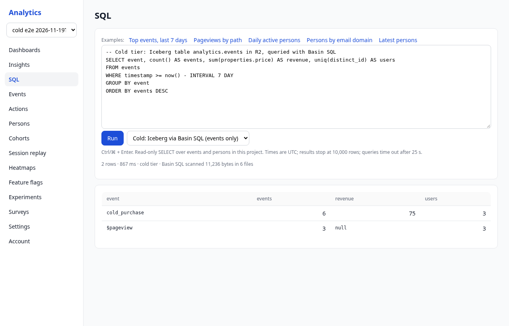
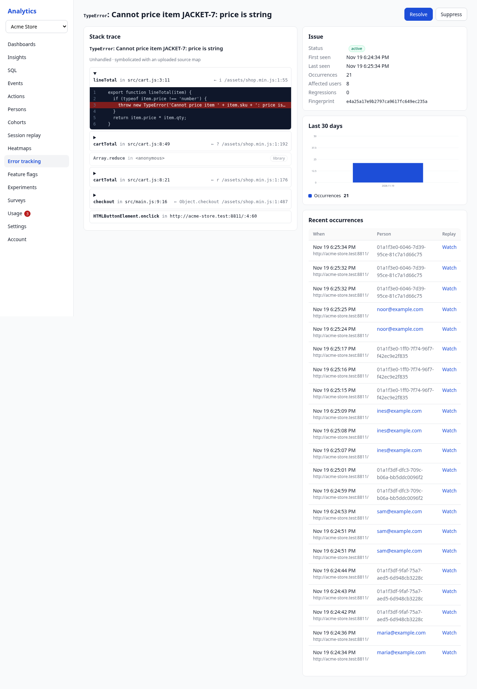
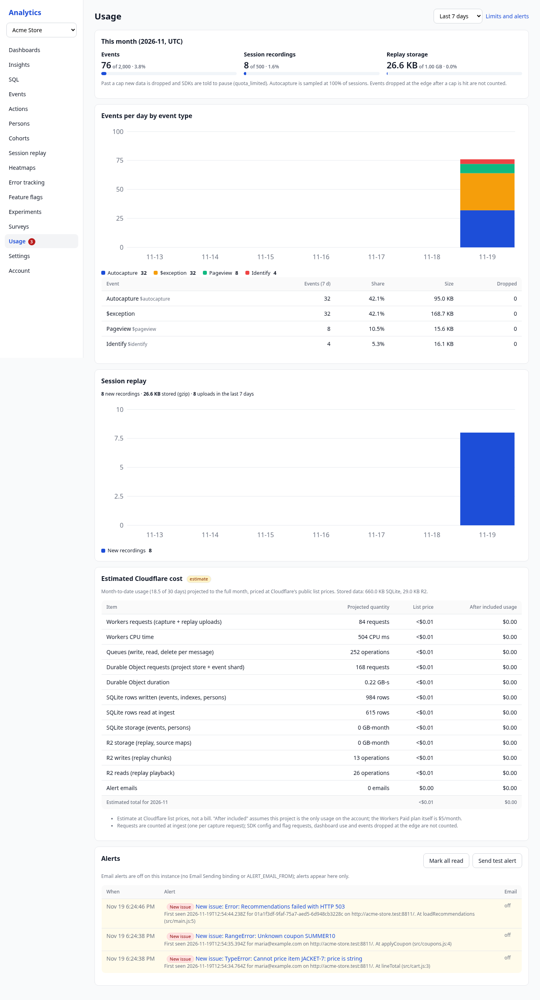
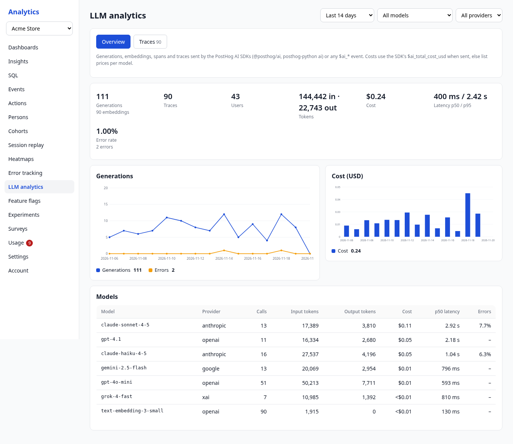
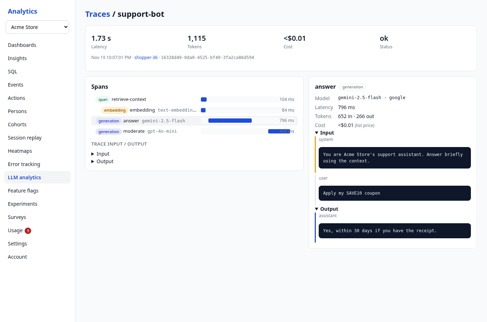
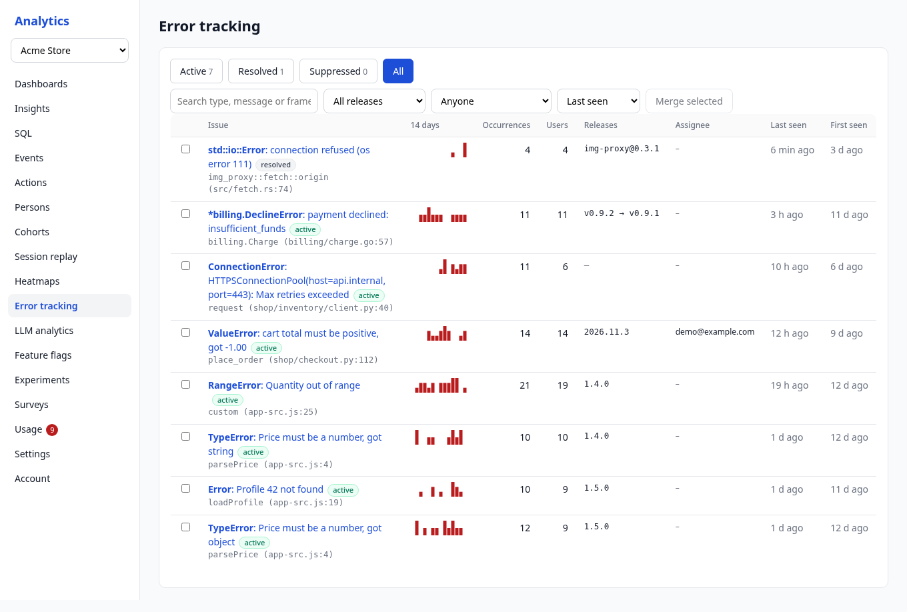
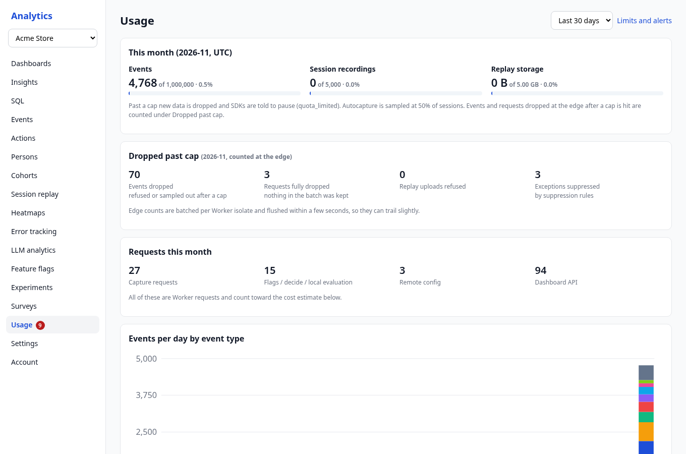
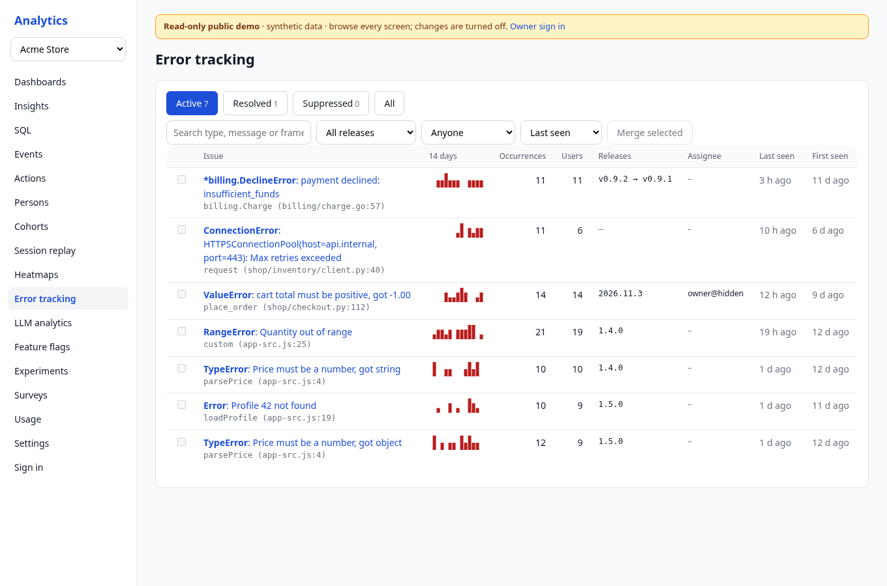

# Product Analytics

Self-hosted product analytics on Cloudflare Workers that the PostHog SDKs
send to unchanged. Point the usual posthog-js snippet (or posthog-node) at
your instance and you get events, identified people, groups, trends,
funnels, retention, dashboards, feature flags (also evaluated locally by
posthog-node), session replay with console and network logs, heatmaps and
scroll depth, actions, cohorts, a read-only SQL editor, experiments,
targeted surveys, error tracking with source maps and releases, LLM
analytics for the PostHog AI SDKs, and per-project usage caps with a usage
page, cost estimate and alerts. Events live in SQLite Durable Objects sharded by
month, so a project is not limited to 10 GB and every count stays exact.

**Spec:** [spekkr.com/dwrtz/product-analytics](https://spekkr.com/dwrtz/product-analytics/)
(version 0.6.0, also in [`spec/`](spec/)). This repo is the reference
implementation of that spec. To build your own from the spec, tell a coding
agent:

> Build the spec at https://spekkr.com/dwrtz/product-analytics/start.md

**Live demo:** [analytics.beef-able.com](https://analytics.beef-able.com),
a read-only public demo with synthetic data (no sign-in needed; see
"Public demo" below).

This is not PostHog and contains no PostHog code. The wire format was
reconstructed from PostHog's MIT-licensed sources and recorded SDK traffic
([`spec/research.md`](spec/research.md)); nothing comes from PostHog's
`ee/` directory. posthog-js (Apache-2.0 and MIT) is served unmodified from
`/static/`. The replay player is rrweb-player (MIT).


## What works

- **Capture**, as the SDKs send it: `/e`, `/i/v0/e`, `/batch`, `/capture`,
  `/track`, `/engage`, v1 `/i/v1/analytics/events`, and the AI endpoints
  `/i/v0/ai/batch`, multipart `/i/v0/ai` and `/i/v1/ai/events`.
  Every body encoding (gzip with or without a hint, LZ64, base64, form
  `data=`), clock-skew correction, dedupe by uuid, Cloudflare geo as
  `$geoip_*`.
- **Persons and groups**: `identify`, `alias`, `$set` / `$set_once` /
  `$unset`, PostHog's merge rules and illegal-id list, personless events,
  `$groupidentify`.
- **Feature flags**: `/flags` and `/decide` with PostHog's hashing, so a
  person gets the same variant as on PostHog; rollouts, person-property
  conditions, multivariate flags, payloads. Remote config (`config.js`).
- **Insights**: trends (count, unique people, sessions, groups, sum, avg,
  min, max, median, percentiles; breakdowns; compare to previous period),
  funnels (ordered as PostHog's funnel UDF, or unordered; conversion
  window; median time), retention (recurring or first time).
- **Session replay**: turn on "Record sessions" in Settings and posthog-js
  loads its recorder and posts to `/s/`; recordings (including
  posthog-js's compressed snapshots) are stored in R2 and played with
  rrweb-player, linked from persons and events. Inputs stay masked as the
  SDK masks them. Kept 30 days by default.
- **Experiments**: on a multivariate flag; exposure from
  `$feature_flag_called`; conversion (funnel), count and sum metrics;
  Bayesian results with credible intervals, chance to be best and uplift.
- **Surveys**: popover and API surveys with rating (NPS), choice, open and
  link questions, served to posthog-js at `/api/surveys`; results from
  the SDK's `survey sent` events.
- **More events**: one Durable Object per project per month plus a head
  object for persons; purge drops whole months. See
  [`spec/design.md`](spec/design.md) "Event shards".
- **Web app**: dashboards, insight editor, events explorer, persons,
  session replay, feature flags, experiments, surveys, project settings
  with the install snippet, personal API keys. Works on a phone.

- **0.3**: actions (CSS selector, text, href, URL matchers) as series,
  funnel steps and cohort criteria; static (CSV) and dynamic cohorts
  (properties, behaviour, other cohorts) as filters in insights, flags,
  surveys and experiments; click, rage-click, dead-click and mouse-move
  heatmaps and scroll depth over the live page or a recording snapshot;
  `POST /api/projects/:id/sql` and an SQL screen (read-only, project
  scoped, across shards, with limits); posthog-node local evaluation
  (`/flags/definitions`, `/api/feature_flag/local_evaluation`); experience
  continuity via `$anon_distinct_id`; survey targeting (cohorts, URL,
  selector, devices, wait period, actions), iterations and partial
  responses; replay sampling, minimum duration, linked flag, URL/event
  triggers, network/console/canvas capture and paged playback (no 64 MB
  cap); funnels and survey results without row limits.
- **0.4**: optional Basin cold tier: every event is also streamed through
  a Basin Pipelines binding (`COLD_STREAM`) into an Apache Iceberg table in
  R2, and the SQL screen gets a Cold source that runs the same query
  language through Basin SQL, always scoped to the project and its
  retention period. Setup: [`spec/design.md`](spec/design.md) "Cold tier".



- **0.5**: error tracking: `$exception` events from posthog-js (exception
  autocapture is switched on through remote config) and posthog-node are
  grouped into issues by fingerprint, with status, occurrences, affected
  users, symbolicated stack traces (upload maps with
  `scripts/upload-sourcemaps.mjs` and a personal API key), person and
  replay links, and new-issue / regression alerts. Usage limits: monthly
  caps on events, recordings and replay bytes, drop or sample past a cap
  (posthog-js is told `quota_limited` and pauses), autocapture and replay
  sampling defaults for new projects, a Usage page with events per day by
  type, replay volume and an estimated Cloudflare cost, and alerts at
  50/80/100% of a cap and on spikes, in the app and optionally by email
  (Cloudflare Email Sending).





- **0.6**: **LLM analytics**: `$ai_generation`, `$ai_trace`, `$ai_span`
  and `$ai_embedding` events from the PostHog AI SDKs (or any sender) give
  an overview (generations, tokens, cost from the SDK or a built-in price
  table, p50/p95 latency, error rate, per-model table) with model,
  provider and error filters, a traces list and a trace page with a span
  tree and latency waterfall. **Error tracking**: releases (`$release` /
  `$app_version`) with per-release source maps and retroactive
  symbolication when a map is uploaded later, index (sectioned) source
  maps, merge and split issues, assign issues to a user, custom grouping
  rules, suppression rules (sent to posthog-js through remote config and
  enforced at ingest), and Python, Go and Rust stacks. **Cold Trends**:
  Trends can read the Basin cold tier (Hot/Cold source), and
  `scripts/cold-prune.py` (PyIceberg, with a scheduled workflow example)
  physically deletes cold rows past retention. **Usage**: flags, remote
  config and API requests are counted, plus events and requests dropped
  past a cap; the cost estimate leads with list price (toggle: after the
  Workers Paid allowance); caps reach every isolate within about 10 s.
  **Public demo** mode (below), and a deep link to any screen loads the
  app directly.











Full, normative detail: [`spec/protocol.md`](spec/protocol.md), with worked
examples in [`spec/test-vectors.json`](spec/test-vectors.json).

## Layout

| Path | What |
|---|---|
| `src/shared/` | Pure wire library: body decoding, tokens, timestamps, ids, flag hashing and matching, date buckets |
| `src/worker/` | The Worker: capture, flags and remote config, queue consumer, owner API, auth, `ProjectStore` (head) and `EventShard` Durable Objects, queries, replay, experiments, surveys, error tracking, usage limits and alerts |
| `src/ui/` | Web app (no framework, SVG charts), bundled into the Worker by `scripts/build-ui.mjs` |
| `migrations/` | D1 schema (instance data: users, sessions, keys, projects; 0002 adds the recording switch, 0004 usage limits and error tracking, 0005 the public demo flag) |
| `tests/`, `e2e/` | Vitest in workerd on the spec vectors and a fixed dataset; end-to-end with posthog-js in Chromium and posthog-node |
| `scripts/` | UI build, SDK copy, demo data, screenshots, source map upload, `cold-prune.py` |
| `spec/` | The Spekkr spec this was built from |

## Run locally

Node 22 or later.

```sh
npm install
npm run dev          # builds, creates wrangler.jsonc, applies local D1 migrations, runs wrangler dev on :8787
npm test             # 212 tests: spec vectors, store and insight maths, HTTP, shards, replay, experiments, surveys, cold tier, errors, usage, LLM, public demo
python3 -m unittest scripts/test_cold_prune.py   # 6 tests for the cold pruning script
npx playwright install chromium
E2E_EMAIL=you@example.com npm run e2e   # against the running dev server
```

Open http://localhost:8787, sign up (the first account owns the instance),
create a project and copy the snippet from Settings. For demo data:
`PA_DEMO_PASSWORD=<password> node scripts/demo-setup.mjs http://localhost:8787 <email>`
(traffic, errors across releases, LLM traces and a capped period, all
idempotent; it ends with the project marked as a public demo).

## Deploy

You need a Cloudflare account with Workers, D1, Durable Objects, Queues
and R2, and a zone for the hostname.

1. `npm install`, then `cp wrangler.example.jsonc wrangler.jsonc` (git-ignored).
2. `npx wrangler d1 create product-analytics` and put the id in `wrangler.jsonc`.
3. `npx wrangler queues create product-analytics-ingest`,
   `npx wrangler queues create product-analytics-ingest-dlq` and
   `npx wrangler r2 bucket create product-analytics-replay`.
4. `npx wrangler d1 migrations apply DB --remote`
5. In `wrangler.jsonc` set `vars.SITE_URL` to `https://analytics.example.com`,
   `ALLOWED_EMAILS` to the emails allowed to sign up (set this before the
   first deploy, or whoever signs up first owns the instance),
   optionally `DEFAULT_RETENTION_DAYS`, and add
   `"routes": [{ "pattern": "analytics.example.com", "custom_domain": true }]`.
6. `npm run deploy`, open the site, sign up, create a project and paste the
   snippet into your site.
7. Measuring a site on another domain: simplest is a separate instance on a
   subdomain of that site (e.g. `analytics.yoursite.com` as `SITE_URL`). To
   instead send its events to this instance through a first-party ingest
   subdomain there, add that hostname as a second custom domain and list it
   in the optional `INGEST_HOSTS` var: it then serves only the SDK
   endpoints, `/static/*`, `/_health` and personal API key calls, and
   dashboard pages redirect to `SITE_URL` (off by default; 0.4.2).

8. Optional alert email: onboard a sender domain to Cloudflare Email
   Sending, then add `"send_email": [{ "name": "EMAIL" }]` and the
   `ALERT_EMAIL_FROM` var (see `wrangler.example.jsonc`). Without them
   alerts appear in the app only.

9. Optional public demo: set the `PUBLIC_DEMO` var to `1` and turn on
   "Public demo" in a project's Settings (see below).
10. Optional cold pruning: copy `scripts/cold-prune.workflow.example.yml`
    into `.github/workflows/` with a `R2_CATALOG_TOKEN` secret and the
    `CF_ACCOUNT_ID`, `COLD_BUCKET` and `RETENTION_DAYS` variables, or run
    `python3 scripts/cold-prune.py --help` by hand.

No secrets are needed by the Worker. Upgrading from 0.5: run step 4 again
(migration 0005, adds `projects.public_demo`) and `npm run deploy`; Durable
Objects upgrade their own tables. Upgrading from 0.4: run step 4 again (migration
0004) and `npm run deploy`; existing projects keep no caps and exception
autocapture off until changed in Settings. Upgrading from 0.2: run step 4 again (migration
0003) and `npm run deploy` (adds the hourly cohort cron). Upgrading from 0.1: create the R2 bucket, run step
4 again (migration 0002) and `npm run deploy`; existing events stay where
they are and new ones go to monthly shards.

## Public demo

With `PUBLIC_DEMO=1`, signed-out visitors can browse every project whose
"Public demo" switch is on, read-only: all screens, insights, SQL and
recordings work, a banner says it is a demo, every write is refused (403
`demo_read_only`) and secrets are redacted (the project token shows as
`phc_demo_token_hidden` and account and alert emails as `owner@hidden`).
Sign-up stays limited by `ALLOWED_EMAILS`, and owners still sign in as
usual. Leave `PUBLIC_DEMO` unset (the default) for a private instance;
[analytics.beef-able.com](https://analytics.beef-able.com) runs with it on.

## Use it from your site

```html
<script>
  !function(t,e){/* the standard posthog-js snippet, as shown in Settings */}(document,window.posthog||[]);
  posthog.init('<project API key>', { api_host: 'https://analytics.example.com', person_profiles: 'identified_only' })
</script>
```

Settings shows the full snippet for your instance. With posthog-node:
`new PostHog('<project API key>', { host: 'https://analytics.example.com' })`.

## Test status

- `npm test`: 212/212 pass (0.6 adds the HTML fallback, public demo,
  usage counter, error tracking 0.6, LLM analytics and cold Trends tests and
  the source-map-section, LLM cost, suppression rule and release vectors;
  0.5 adds error tracking, source map, usage cap, sampling and alert tests plus their vectors; 0.4 the cold-tier compiler tests, 0.4.1/0.4.2 the ingest-only hostname tests).
- `npm run typecheck`: passes.
- `python3 -m unittest scripts/test_cold_prune.py`: 6/6 pass.
- `npm run e2e`: 85/85 checks pass (0.6 adds deep links, Python/Go/Rust
  stacks, releases with retroactive symbolication, grouping and
  suppression rules in remote config and at ingest, merge/split/assign,
  LLM events through posthog-node, the AI batch and multipart endpoints
  and their screens, request and dropped-past-cap counters, and the public
  demo as a signed-out visitor; 0.5 adds exception autocapture with real posthog-js, a posthog-node exception, the issues and issue pages, the usage page, and posthog-js pausing after `quota_limited`; 0.3 adds actions, cohorts, SQL,
  heatmaps, scroll depth, console/network capture, continuity, partial
  survey responses, posthog-node local evaluation and their screens; earlier: (posthog-js snippet on a separate
  origin, posthog-node capture, identify, alias and flags; stored events,
  merged persons, trend, funnel and retention numbers; a real recording
  with the password absent; a survey answered in the posthog-js popover;
  experiment exposure; UI including the replay player).
- REA conformance captures of real posthog-js against this build: 0.1
  16/16, 0.2 (recorder, surveys, exposure) 22/22 and 0.3 (heatmaps,
  console/network/canvas, continuity, partial surveys) 30/30 SDK requests
  succeed.
- Live 0.6 (2026-11-20): `npm run e2e` against analytics.beef-able.com
  85/85; cold-tier Trends 14/14 (events reached Iceberg in about a
  minute, exact totals, distinct ids and sessions matching the hot engine,
  a 400-day-old event excluded by the 365-day retention, breakdowns and
  funnels refused on cold); the signed-out public demo 72/72 (every screen's
  API answers with demo data, tokens and emails masked, 20/20 writes refused
  with `demo_read_only`, stranger sign-up 403); analytics.spekkr.com
  (private) smoke 23/23 (AI batch endpoint, releases, suppression rules
  through remote config, merge, request counters, signed-out API 401).
- Live cold tier (0.4, analytics.beef-able.com): events sent to `/batch`
  appeared in the Iceberg table and in cold SQL results after about two
  minutes; an event older than the 365-day retention was excluded; 14/14
  checks.

## Not in 0.6

- Data warehouse, CDP / data pipelines and notebooks.
- Full HogQL (joins, subqueries); the SQL screen is a project-scoped
  subset.
- Lifecycle, stickiness and paths insights.
- The toolbar and element clickmaps.
- Web experiments and product tours.
- Organizations, SSO and billing (one instance, an email allow list).
- Native mobile (iOS/Android) symbolication (dSYM, ProGuard).
- Physical deletion of cold rows inside the Worker: Basin SQL is
  read-only, so retention is applied to every cold query and
  [`scripts/cold-prune.py`](scripts/cold-prune.py) deletes expired rows
  outside it.
- Scale and load testing (no published numbers for 10M+ events a month).

## License

MIT. posthog-js, served from `/static/`, is licensed by PostHog, Inc. under
Apache-2.0 and MIT; its licence is copied next to it at build time.
rrweb-player (bundled into `/player.js`) is MIT, by the rrweb authors.
