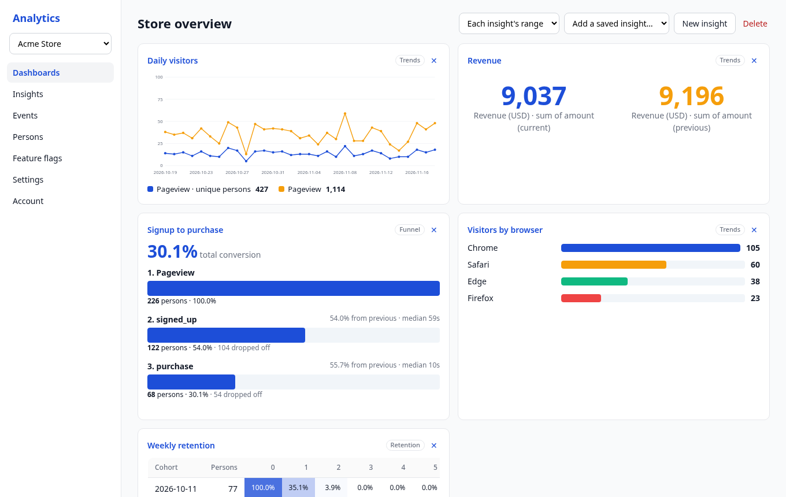

# Product Analytics

Self-hosted product analytics on Cloudflare Workers that the PostHog SDKs
send to unchanged. Point the usual posthog-js snippet (or posthog-node) at
your instance and you get events, identified people, groups, trends,
funnels, retention, dashboards and feature flags, stored in one SQLite
Durable Object per project.

**Spec:** [spekkr.com/dwrtz/product-analytics](https://spekkr.com/dwrtz/product-analytics/)
(version 0.1.1, also in [`spec/`](spec/)). This repo is the reference
implementation of that spec.

This is not PostHog and contains no PostHog code. The wire format was
reconstructed from PostHog's MIT-licensed sources and recorded SDK traffic
([`spec/research.md`](spec/research.md)); nothing comes from PostHog's
`ee/` directory. posthog-js (Apache-2.0 and MIT) is served unmodified from
`/static/`.



## What works

- **Capture**, as the SDKs send it: `/e`, `/i/v0/e`, `/batch`, `/capture`,
  `/track`, `/engage`, `/i/v0/ai/batch` and v1 `/i/v1/analytics/events`.
  Every body encoding (gzip with or without a hint, LZ64, base64, form
  `data=`), clock-skew correction, dedupe by uuid, Cloudflare geo as
  `$geoip_*`.
- **Persons and groups**: `identify`, `alias`, `$set` / `$set_once` /
  `$unset`, PostHog's merge rules and illegal-id list, personless events,
  `$groupidentify`.
- **Feature flags**: `/flags` and `/decide` with PostHog's hashing, so a
  person gets the same variant as on PostHog; rollouts, person-property
  conditions, multivariate flags, payloads. Remote config (`config.js`).
- **Insights**: trends (count, unique people, sessions, groups, sum, avg,
  min, max, median, percentiles; breakdowns; compare to previous period),
  funnels (ordered as PostHog's funnel UDF, or unordered; conversion
  window; median time), retention (recurring or first time).
- **Web app**: dashboards, insight editor, events explorer, persons,
  feature flags, project settings with the install snippet, personal API
  keys. Works on a phone.

Full, normative detail: [`spec/protocol.md`](spec/protocol.md), with worked
examples in [`spec/test-vectors.json`](spec/test-vectors.json).

## Layout

| Path | What |
|---|---|
| `src/shared/` | Pure wire library: body decoding, tokens, timestamps, ids, flag hashing and matching, date buckets |
| `src/worker/` | The Worker: capture, flags and remote config, queue consumer, owner API, auth, `ProjectStore` Durable Object, queries |
| `src/ui/` | Web app (no framework, SVG charts), bundled into the Worker by `scripts/build-ui.mjs` |
| `migrations/` | D1 schema (instance data: users, sessions, keys, projects) |
| `tests/`, `e2e/` | Vitest in workerd on the spec vectors and a fixed dataset; end-to-end with posthog-js in Chromium and posthog-node |
| `scripts/` | UI build, SDK copy, demo data, screenshots |
| `spec/` | The Spekkr spec this was built from |

## Run locally

Node 22 or later.

```sh
npm install
npm run dev          # builds, creates wrangler.jsonc, applies local D1 migrations, runs wrangler dev on :8787
npm test             # 86 tests: spec vectors, store and insight maths, HTTP
npx playwright install chromium
E2E_EMAIL=you@example.com npm run e2e   # against the running dev server
```

Open http://localhost:8787, sign up (the first account owns the instance),
create a project and copy the snippet from Settings. For demo data:
`node scripts/demo-setup.mjs http://localhost:8787 <email> <password>`.

## Deploy

You need a Cloudflare account with Workers, D1, Durable Objects and Queues,
and a zone for the hostname.

1. `npm install`, then `cp wrangler.example.jsonc wrangler.jsonc` (git-ignored).
2. `npx wrangler d1 create product-analytics` and put the id in `wrangler.jsonc`.
3. `npx wrangler queues create product-analytics-ingest` and
   `npx wrangler queues create product-analytics-ingest-dlq`.
4. `npx wrangler d1 migrations apply DB --remote`
5. In `wrangler.jsonc` set `vars.SITE_URL` to `https://analytics.example.com`,
   `ALLOWED_EMAILS` to the emails allowed to sign up (set this before the
   first deploy, or whoever signs up first owns the instance),
   optionally `DEFAULT_RETENTION_DAYS`, and add
   `"routes": [{ "pattern": "analytics.example.com", "custom_domain": true }]`.
6. `npm run deploy`, open the site, sign up, create a project and paste the
   snippet into your site.

No secrets are needed. Each project lives in its own Durable Object (10 GB);
set a retention in Settings to stay under it.

## Use it from your site

```html
<script>
  !function(t,e){/* the standard posthog-js snippet, as shown in Settings */}(document,window.posthog||[]);
  posthog.init('<project API key>', { api_host: 'https://analytics.example.com', person_profiles: 'identified_only' })
</script>
```

Settings shows the full snippet for your instance. With posthog-node:
`new PostHog('<project API key>', { host: 'https://analytics.example.com' })`.

## Test status

- `npm test`: 86/86 pass.
- `npm run typecheck`: passes.
- `npm run e2e`: 23/23 checks pass (posthog-js snippet on a separate
  origin, posthog-node capture, identify, alias and flags; stored events,
  merged persons, trend, funnel and retention numbers; UI).
- The same e2e against a deployed instance (`SITE=https://… npm run e2e`):
  all checks pass.
- REA conformance capture of real posthog-js against this build: 16/16 SDK
  requests succeed.

## Not in 0.1

Session replay, experiments, surveys, cohorts, actions, HogQL, local flag
evaluation, data warehouse and exports. Replay data sent by the SDK is
accepted and discarded.

## License

MIT. posthog-js, served from `/static/`, is licensed by PostHog, Inc. under
Apache-2.0 and MIT; its licence is copied next to it at build time.
