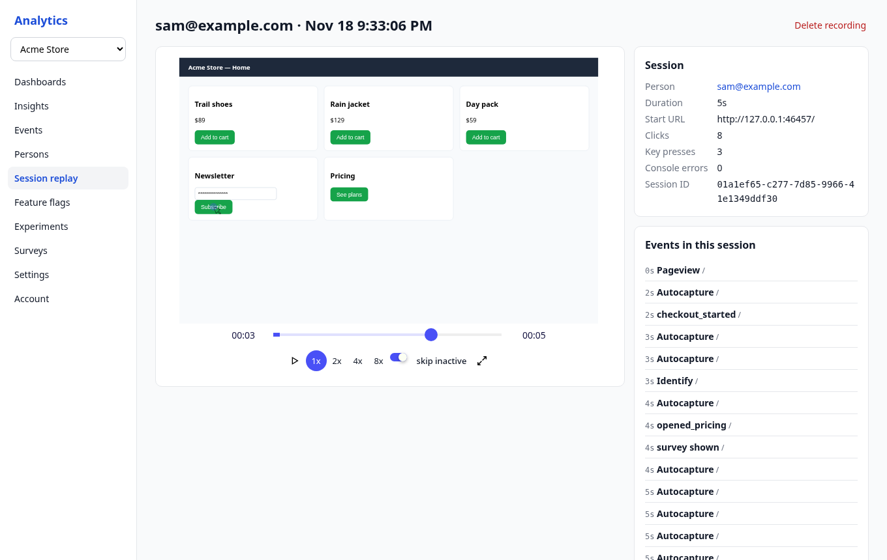
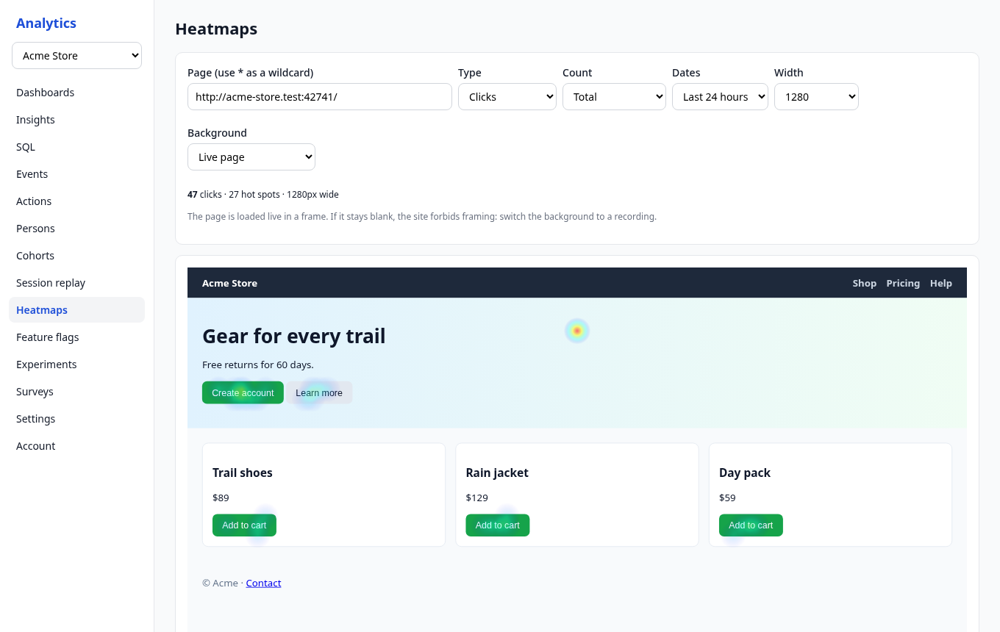

# Product Analytics

Self-hosted product analytics on Cloudflare Workers that the PostHog SDKs
send to unchanged. Point the usual posthog-js snippet (or posthog-node) at
your instance and you get events, identified people, groups, trends,
funnels, retention, dashboards, feature flags (also evaluated locally by
posthog-node), session replay with console and network logs, heatmaps and
scroll depth, actions, cohorts, a read-only SQL editor, experiments and
targeted surveys. Events live in SQLite Durable Objects sharded by
month, so a project is not limited to 10 GB and every count stays exact.

**Spec:** [spekkr.com/dwrtz/product-analytics](https://spekkr.com/dwrtz/product-analytics/)
(version 0.4.0, also in [`spec/`](spec/)). This repo is the reference
implementation of that spec.

This is not PostHog and contains no PostHog code. The wire format was
reconstructed from PostHog's MIT-licensed sources and recorded SDK traffic
([`spec/research.md`](spec/research.md)); nothing comes from PostHog's
`ee/` directory. posthog-js (Apache-2.0 and MIT) is served unmodified from
`/static/`. The replay player is rrweb-player (MIT).






## What works

- **Capture**, as the SDKs send it: `/e`, `/i/v0/e`, `/batch`, `/capture`,
  `/track`, `/engage`, `/i/v0/ai/batch` and v1 `/i/v1/analytics/events`.
  Every body encoding (gzip with or without a hint, LZ64, base64, form
  `data=`), clock-skew correction, dedupe by uuid, Cloudflare geo as
  `$geoip_*`.
- **Persons and groups**: `identify`, `alias`, `$set` / `$set_once` /
  `$unset`, PostHog's merge rules and illegal-id list, personless events,
  `$groupidentify`.
- **Feature flags**: `/flags` and `/decide` with PostHog's hashing, so a
  person gets the same variant as on PostHog; rollouts, person-property
  conditions, multivariate flags, payloads. Remote config (`config.js`).
- **Insights**: trends (count, unique people, sessions, groups, sum, avg,
  min, max, median, percentiles; breakdowns; compare to previous period),
  funnels (ordered as PostHog's funnel UDF, or unordered; conversion
  window; median time), retention (recurring or first time).
- **Session replay**: turn on "Record sessions" in Settings and posthog-js
  loads its recorder and posts to `/s/`; recordings (including
  posthog-js's compressed snapshots) are stored in R2 and played with
  rrweb-player, linked from persons and events. Inputs stay masked as the
  SDK masks them. Kept 30 days by default.
- **Experiments**: on a multivariate flag; exposure from
  `$feature_flag_called`; conversion (funnel), count and sum metrics;
  Bayesian results with credible intervals, chance to be best and uplift.
- **Surveys**: popover and API surveys with rating (NPS), choice, open and
  link questions, served to posthog-js at `/api/surveys`; results from
  the SDK's `survey sent` events.
- **More events**: one Durable Object per project per month plus a head
  object for persons; purge drops whole months. See
  [`spec/design.md`](spec/design.md) "Event shards".
- **Web app**: dashboards, insight editor, events explorer, persons,
  session replay, feature flags, experiments, surveys, project settings
  with the install snippet, personal API keys. Works on a phone.

- **0.3**: actions (CSS selector, text, href, URL matchers) as series,
  funnel steps and cohort criteria; static (CSV) and dynamic cohorts
  (properties, behaviour, other cohorts) as filters in insights, flags,
  surveys and experiments; click, rage-click, dead-click and mouse-move
  heatmaps and scroll depth over the live page or a recording snapshot;
  `POST /api/projects/:id/sql` and an SQL screen (read-only, project
  scoped, across shards, with limits); posthog-node local evaluation
  (`/flags/definitions`, `/api/feature_flag/local_evaluation`); experience
  continuity via `$anon_distinct_id`; survey targeting (cohorts, URL,
  selector, devices, wait period, actions), iterations and partial
  responses; replay sampling, minimum duration, linked flag, URL/event
  triggers, network/console/canvas capture and paged playback (no 64 MB
  cap); funnels and survey results without row limits.
- **0.4**: optional Basin cold tier: every event is also streamed through
  a Basin Pipelines binding (`COLD_STREAM`) into an Apache Iceberg table in
  R2, and the SQL screen gets a Cold source that runs the same query
  language through Basin SQL, always scoped to the project and its
  retention period. Setup: [`spec/design.md`](spec/design.md) "Cold tier".


Full, normative detail: [`spec/protocol.md`](spec/protocol.md), with worked
examples in [`spec/test-vectors.json`](spec/test-vectors.json).

## Layout

| Path | What |
|---|---|
| `src/shared/` | Pure wire library: body decoding, tokens, timestamps, ids, flag hashing and matching, date buckets |
| `src/worker/` | The Worker: capture, flags and remote config, queue consumer, owner API, auth, `ProjectStore` (head) and `EventShard` Durable Objects, queries, replay, experiments, surveys |
| `src/ui/` | Web app (no framework, SVG charts), bundled into the Worker by `scripts/build-ui.mjs` |
| `migrations/` | D1 schema (instance data: users, sessions, keys, projects; 0002 adds the recording switch) |
| `tests/`, `e2e/` | Vitest in workerd on the spec vectors and a fixed dataset; end-to-end with posthog-js in Chromium and posthog-node |
| `scripts/` | UI build, SDK copy, demo data, screenshots |
| `spec/` | The Spekkr spec this was built from |

## Run locally

Node 22 or later.

```sh
npm install
npm run dev          # builds, creates wrangler.jsonc, applies local D1 migrations, runs wrangler dev on :8787
npm test             # 103 tests: spec vectors, store and insight maths, HTTP, shards, replay, experiments, surveys
npx playwright install chromium
E2E_EMAIL=you@example.com npm run e2e   # against the running dev server
```

Open http://localhost:8787, sign up (the first account owns the instance),
create a project and copy the snippet from Settings. For demo data:
`node scripts/demo-setup.mjs http://localhost:8787 <email> <password>`.

## Deploy

You need a Cloudflare account with Workers, D1, Durable Objects, Queues
and R2, and a zone for the hostname.

1. `npm install`, then `cp wrangler.example.jsonc wrangler.jsonc` (git-ignored).
2. `npx wrangler d1 create product-analytics` and put the id in `wrangler.jsonc`.
3. `npx wrangler queues create product-analytics-ingest`,
   `npx wrangler queues create product-analytics-ingest-dlq` and
   `npx wrangler r2 bucket create product-analytics-replay`.
4. `npx wrangler d1 migrations apply DB --remote`
5. In `wrangler.jsonc` set `vars.SITE_URL` to `https://analytics.example.com`,
   `ALLOWED_EMAILS` to the emails allowed to sign up (set this before the
   first deploy, or whoever signs up first owns the instance),
   optionally `DEFAULT_RETENTION_DAYS`, and add
   `"routes": [{ "pattern": "analytics.example.com", "custom_domain": true }]`.
6. `npm run deploy`, open the site, sign up, create a project and paste the
   snippet into your site.
7. Measuring a site on another domain: simplest is a separate instance on a
   subdomain of that site (e.g. `analytics.yoursite.com` as `SITE_URL`). To
   instead send its events to this instance through a first-party ingest
   subdomain there, add that hostname as a second custom domain and list it
   in the optional `INGEST_HOSTS` var: it then serves only the SDK
   endpoints, `/static/*`, `/_health` and personal API key calls, and
   dashboard pages redirect to `SITE_URL` (off by default; 0.4.2).

No secrets are needed. Upgrading from 0.2: run step 4 again (migration
0003) and `npm run deploy` (adds the hourly cohort cron). Upgrading from 0.1: create the R2 bucket, run step
4 again (migration 0002) and `npm run deploy`; existing events stay where
they are and new ones go to monthly shards.

## Use it from your site

```html
<script>
  !function(t,e){/* the standard posthog-js snippet, as shown in Settings */}(document,window.posthog||[]);
  posthog.init('<project API key>', { api_host: 'https://analytics.example.com', person_profiles: 'identified_only' })
</script>
```

Settings shows the full snippet for your instance. With posthog-node:
`new PostHog('<project API key>', { host: 'https://analytics.example.com' })`.

## Test status

- `npm test`: 130/130 pass (0.4 adds the cold-tier compiler tests, 0.4.1/0.4.2 the ingest-only hostname tests).
- `npm run typecheck`: passes.
- `npm run e2e`: 49/49 checks pass (0.3 adds actions, cohorts, SQL,
  heatmaps, scroll depth, console/network capture, continuity, partial
  survey responses, posthog-node local evaluation and their screens; earlier: (posthog-js snippet on a separate
  origin, posthog-node capture, identify, alias and flags; stored events,
  merged persons, trend, funnel and retention numbers; a real recording
  with the password absent; a survey answered in the posthog-js popover;
  experiment exposure; UI including the replay player).
- REA conformance captures of real posthog-js against this build: 0.1
  16/16, 0.2 (recorder, surveys, exposure) 22/22 and 0.3 (heatmaps,
  console/network/canvas, continuity, partial surveys) 30/30 SDK requests
  succeed.
- Live cold tier (0.4, analytics.beef-able.com): events sent to `/batch`
  appeared in the Iceberg table and in cold SQL results after about two
  minutes; an event older than the 365-day retention was excluded; 14/14
  checks.

## Not in 0.4

Data warehouse exports; insights over the cold tier (it is reachable from
SQL only) and physical deletion of expired cold rows (Basin SQL is
read-only; retention is applied to every cold query); full HogQL (joins, subqueries); lifecycle, stickiness and paths;
toolbar and element clickmaps; web experiments and product tours.

## License

MIT. posthog-js, served from `/static/`, is licensed by PostHog, Inc. under
Apache-2.0 and MIT; its licence is copied next to it at build time.
rrweb-player (bundled into `/player.js`) is MIT, by the rrweb authors.
